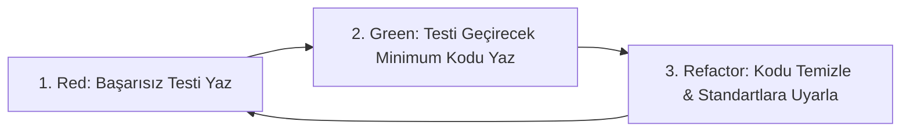

# AGENTS.md - Namazgâh Android Uygulaması (Prayer Times App)

Bu dosya, projede çalışan tüm yapay zeka ajanları (agents) ve geliştiriciler için projenin temel mimari kararlarını, geliştirme metodolojisini, dizin yapısını ve test standartlarını belirleyen tek doğruluk kaynağıdır (Single Source of Truth).

---

## 1. Temel Proje Kararları (Core Decisions)

| Alan | Karar | Açıklama |
| :--- | :--- | :--- |
| **Platform** | **Native Android** | Modern Kotlin & Jetpack Compose (Material 3). |
| **Kod Mimarisi** | **Package-by-Feature Clean Architecture** | Tek modül içerisinde özellik odaklı (`feature-first`) paketleme. |
| **Durum Yönetimi** | **MVI (Model-View-Intent) + UDF** | Tek yönlü veri akışı (`UiState`, `UiIntent`/`UiEvent`, `UiEffect`). |
| **Geliştirme Metodolojisi** | **Test Driven Development (TDD)** | Önce test yazılır (Red), kod yazılıp test geçirilir (Green), sonra yeniden düzenlenir (Refactor). |
| **Test Piramidi** | **Unit Tests + Integration Tests + E2E Tests** | Kapsamlı test stratejisi (JUnit 5 / MockK / Turbine / Compose Test Rule / Espresso). |
| **Konum & GPS** | **FusedLocationProvider + Reverse Geocoding** | Düşük pil tüketimli one-shot konum tespiti ve Türkiye il/ilçe adı eşleme. |
| **Akıllı Senkronizasyon** | **WorkManager Günlük Kontrol + Wi-Fi Kuralı** | Ay sonuna 10 gün kala sonraki ay kontrol edilir; indirme yalnızca Wi-Fi'de, ay sonuna ≤2 gün kalınca mobil veriye de izin verilir. Günlük `SmartSyncWorker` (`smart_monthly_sync` işi) uygular; yeni ay indirildiğinde vakit alarmları da yeniden kurulur (`SmartSyncCoordinator`). |
| **Kıble Pusulası** | **Rotation Vector Sensor + Spherical Trigonometry** | Kabe açısı matematiksel hesabı, canlı pusula ibresi ve titreşimli hizalama geri bildirimi. Kıble sekmesi görünürken sensör açılır, sekme değişince kapatılır. |
| **Tema** | **Sistem Takipli Açık/Koyu + Turuncu Marka** | `NamazVakitleriTheme(darkTheme = isSystemInDarkTheme())`; koyu turuncu-kahve varsayılan marka görünümü, açık tema sistem ayarını takip eder. |
| **Marka & Simge** | **Namazgâh + Adaptif Simge** | Uygulama adı `Namazgâh`; simge `mipmap-anydpi-v26` adaptif (turuncu gradyan zemin + beyaz Ortaköy Camii silüeti: tek kubbe, iki ince minare, sivri külahlar, kemerli pencereler), yuvarlak varyant ve Android 13 temalı simge (monochrome) desteği. Eski PNG yoğunlukları korunur. |
| **Veri & Senkronizasyon** | **Offline-First Room DB + Aladhan (Diyanet Method=13)** | Vakitler 30-90 günlük yerel veritabanında saklanır; Aladhan Diyanet API'si ile senkronize edilir. |
| **Alarmlar & Ses** | **Exact AlarmManager + Foreground Audio** | Uyku modunda (Doze Mode) bile şaşmayan vakit bildirimleri ve Media3 ile özel MP3 desteği. |
| **Vakit Uyarı Kuralları** | **Zil Moduna Duyarlı Uyarı (PrayerAlertPolicy)** | Telefon sesliyken (`RINGER_MODE_NORMAL`) yalnızca ses çalınır, metin bildirimi gönderilmez. Telefon sessiz/titreşimdeyken veya vakit sesi "Sessiz" seçiliyse yalnızca sessiz kanaldan metin bildirimi gelir. Ses `AdhanPlaybackService` (foreground, `mediaPlayback`, `USAGE_ALARM`) ile çalınır; "Ses çalıyor" bildirimi yalnızca çalma süresince görünür ve Durdur aksiyonu içerir. |
| **Ses Seviyesi & Gecikme** | **Uygulama İçi Ses + Vakit Başına Gecikme** | Genel ses seviyesi (`global_volume`, %0-100) sistem sesinden bağımsızdır ve tek kaydırıcıdan yönetilir. Her vakit için ses gecikmesi 0/1/2/5/10/15/30 dk seçilebilir; gecikme ikinci aşama exact alarm (`AlarmItem.isDelayedAlert`) ile uygulanır, widget vakit girişinde tazelenir. Tüm ses/gecikme ayarları Ayarlar > Ezan ve Sesler ekranındadır; Bildirimler ekranında yalnızca aç/kapat ve titreşim bulunur. |
| **Özel Ses & MP3** | **Media3 ExoPlayer + ACTION_OPEN_DOCUMENT + DataStore** | Vakit bazlı bağımsız ses atama, cihazdan MP3 seçme, kalıcı okuma izni (`takePersistableUriPermission`), Türk makamları ezanları ve canlı önizleme dinleme. |
| **İbadet & Takip** | **Zikirmatik (Sadece Zikir)** | Tam ekran dokunmatik zikir, 33/99/100 hedef tur sayacı ve titreşimli geri bildirim. Kaza namazı takibi **yoktur** (bkz. Bölüm 4.5). |
| **Aylık İmsakiye** | **Ramazan İmsakiyesi + 30 Günlük Çizelge** | Sahur & İftar geri sayımı, İftar duası, Cuma vurgusu, oruç takip çetelesi ve WhatsApp paylaşım desteği. |
| **Derleme & Çıktı** | **Gradle 9.9.1 + AGP 9.5.1 + Kotlin 2.4.21 + KSP 2.3.14 + Java 21** | AGP 9 yerleşik Kotlin kullanır; `org.jetbrains.kotlin.android` eklentisi yoktur. `sourceCompatibility`/`targetCompatibility` = Java 21, `compileSdk = 37`, `targetSdk = 37`. `./gradlew testDebugUnitTest` & `./gradlew assembleDebug` -> `app-debug.apk`. `./gradlew dependencyUpdates` raporu `build/dependencyUpdates/report.txt`. |
| **Navigasyon** | **Jetpack Navigation + Material 3 NavigationBar** | 4 temel sekme (Vakitler, İmsakiye, Kıble, Zikir). Sesler ve Ayarlar alt ekranlardan açılır; yaşlı dostu kalıcı metin etiketleri ve akıcı geri yığını yönetimi. |
| **Widget Mimarisi** | **Jetpack Glance + RemoteViews** | Küçük (2x2) ve Büyük (4x2) ana ekran widget'ları; Room'dan gerçek veri (konum + 6 vakit; büyükte ayrıca sıradaki vakit ve kalan süre). İçerik `AndroidRemoteViews` ile çizilir, renkler `@color`/`@drawable` kaynaklarından çözülür → sistem teması değişiminde uygulama süreci çalışmasa da anında güncellenir. Geri sayım `Chronometer` ile sistem saatiyle senkron. Güncelleme tetikleri: uygulama açılışı, vakit alarmı, reboot, sistem 30 dk. |
| **Hedef Kitle & UX** | **Yaşlı Dostu & Erişilebilirlik Odaklı** | Dinamik font ölçekleme, Sade Mod (Simple Mode), büyük dokunma alanları (min 56dp). |

---

## 2. Dizin & Paket Mimarisi (Package-by-Feature Structure)

Proje `com.anttech.prayertimes` ana paketi altında şu şekilde organize edilir:

```
namaz-vakitleri/
├── app/src/main/java/com/anttech/prayertimes/
│   ├── core/
│   │   ├── common/              # BaseViewModel, Dispatchers, Result wrapper, Date/Time utils
│   │   ├── database/            # Room Database, TypeConverters, Migration
│   │   ├── network/             # Ktor / Retrofit API client, Diyanet/Aladhan DTOs
│   │   ├── location/            # FusedLocationProviderClient, Geocoder, LocationService
│   │   ├── notifications/       # AlarmManager, WorkManager, NotificationManager, SoundPlayer
│   │   ├── sensor/              # Compass, Magnetometer, Gyroscope (Kıble hesaplama)
│   │   └── ui/                  # Material 3 Theme, Typography, Reusable UI Components, Font Scale
│   │
│   ├── features/
│   │   ├── times/               # Ana Ekran, Geri Sayım, Günün Vakitleri
│   │   │   ├── data/            # TimesRepository, TimesLocalDataSource, TimesRemoteDataSource
│   │   │   ├── domain/          # GetTodayPrayerTimesUseCase, GetNextPrayerCountdownUseCase
│   │   │   ├── ui/              # TimesScreen, TimesViewModel, TimesUiState, TimesIntent
│   │   │   └── components/      # CountdownRing, PrayerTimeCard, DailyAyahCard
│   │   │
│   │   ├── qibla/               # Kıble Pusulası Ekranı
│   │   │   ├── domain/          # CalculateQiblaAngleUseCase
│   │   │   └── ui/              # QiblaScreen, QiblaViewModel, CompassGraphic
│   │   │
│   │   ├── calendar/            # Aylık İmsakiye & Takvim
│   │   │   └── ui/              # CalendarScreen, ImsakiyeExportPdfHelper
│   │   │
│   │   ├── tracker/             # Zikirmatik
│   │   │   ├── domain/          # DhikrPreset, DhikrCounterUseCase
│   │   │   └── ui/              # TrackerScreen (DhikrScreen), FullscreenTouchDetector
│   │   │                        # NOT: Kaza ekranı/verisi yoktur (bkz. Bölüm 4.5)
│   │   │
│   │   ├── settings/            # Bildirimler, Ses Seçimi, Şehir Seçimi, İzinler, Erişilebilirlik
│   │   │   ├── data/            # SettingsPreferences (DataStore: ses, bildirim tercihleri)
│   │   │   └── ui/              # SettingsScreen, NotificationSettingsScreen, PermissionsScreen, SoundPickerScreen, FontSizeSettings
│   │   │
│   │   └── widget/              # Jetpack Glance Masaüstü Widget'ları
│   │       ├── SmallPrayerWidget.kt (2x2 Minimal)
│   │       ├── LargePrayerWidget.kt (4x2 Tam Pano)
│   │       ├── GetWidgetTimesUseCase.kt (widget modeli)
│   │       ├── WidgetDataLoader.kt (Hilt EntryPoint + marka renkleri)
│   │       └── WidgetUpdater.kt (tetiklerle yeniden çizim)
│   │
│   └── MainActivity.kt          # Root NavHost & Top-level theme container
│
├── app/src/test/java/com/anttech/prayertimes/          # Unit & Integration Tests
└── app/src/androidTest/java/com/anttech/prayertimes/    # UI & E2E Tests
```

---

## 3. Test Odaklı Geliştirme (TDD) Standartları

Her ajan veya geliştirici kod yazarken şu sıralamaya **kesinlikle uymalıdır**:



### 3.1. Birim Testler (Unit Tests)
- **Konum:** `app/src/test/java/...`
- **Kapsam:** 
  - `UseCase` sınıfları (Vakit hesaplama, sonraki vakit geri sayımı, kıble açısı formülü).
  - `ViewModel` sınıfları (MVI State akışı, Intent işleme, Effect fırlatma).
  - `Repository` sınıfları (Offline-first mantığı, network fallback).
  - `AudioPlayer` ve `TimeUtils` yardımcı sınıfları.
- **Araçlar:** JUnit 5, MockK, Kotlinx Coroutines Test, Turbine (Flow doğrulamaları), Truth / AssertJ.

### 3.2. Entegrasyon Testleri (Integration Tests)
- **Konum:** `app/src/test/java/...` veya `app/src/androidTest/java/...`
- **Kapsam:**
  - `Room Database & DAOs` (In-memory Room DB ile vakit ekleme, sorgulama, güncelleme).
  - `AlarmManager Scheduler & Receiver` (Alarm kurulması ve alarmların doğru tetiklenmesi).
  - `Location Provider & Geocoder` entegrasyonu.
  - `DataStore Preferences` (Kullanıcı font boyutu, seçili ses dosyası yolu saklama).
- **Araçlar:** Robolectric / AndroidX Test Runner, In-memory Room DB.

### 3.3. Uçtan Uca (E2E) ve UI Testleri
- **Konum:** `app/src/androidTest/java/...`
- **Kapsam:**
  - Kullanıcı akışı: Şehir seçimi -> Ana ekranda vakitlerin görünmesi -> Geri sayımın akması.
  - Ayarlar akışı: Font boyutunu büyütme -> Arayüzdeki yazıların büyüdüğünün UI doğrulaması.
  - Ezan sesi seçimi akışı: Özel ses seçimi dialogu -> Kaydetme -> Alarm simülasyonu.
  - Zikirmatik akışı: Tıklama -> Sayacın 33'e ulaşıp titreşim vermesi.
- **Araçlar:** Jetpack Compose `createComposeRule()`, UI Automator, Espresso.

---

## 4. Kodlama ve Mimari Kuralları (Guidelines for Agents)

1. **Unidirectional Data Flow (UDF):**
   - Her ekranın yalnızca bir adet `UiState` veri sınıfı olmalıdır.
   - UI katmanı ViewModel'e yalnızca `sendIntent(UiIntent)` ile haber verir.
   - Tek seferlik olaylar (Toast, Dialog, Ses çalma) için `SharedFlow<UiEffect>` veya `Channel<UiEffect>` kullanılır.
2. **Offline-First:**
   - Ağ bağlantısı yokken hiçbir ekran boş veya hata ekranı göstermemelidir; Room'daki en son veriler anında ekranda olmalıdır.
3. **Erişilebilirlik (Accessibility):**
   - Sabit `dp` ve `sp` değerleri yerine font scaling çarpanına uygun dinamik `sp` kullanılmalı.
   - Dokunma hedefleri (`clickable` veya `Button`) minimum 56x56dp olmalıdır.
   - Tüm ikonlarda ve butonlarda anlamlı Türkçe `contentDescription` bulunmalıdır.
4. **Dokümantasyon Bütünlüğü:**
   - Kod değişikliklerinde var olan testler ve yorumlar korunmalıdır.
   - Her yeni özellik öncesinde ilgili birim testi yazılmalıdır (TDD).

5. **KAPSAM DIŞI: Kaza Namazı Özelliği YOKTUR:**
   - Bu uygulamada kaza namazı **özelliği, ekranı, sekmesi, sayacı, çetelesi veya veritabanı tablosu yoktur** ve olmayacaktır.
   - Kaza ile ilgili hiçbir UI öğesi eklenmemelidir: sekme, menü satırı, kart, buton (+1/+5), "borç/tahmini bitiş" göstergesi, bildirim veya metin.
   - `Tracker` (Zikir) modülü yalnızca zikirmatik içerir: tam ekran dokunma alanı, 33/99/100 hedefli tur sayacı ve titreşim.
   - Ajanlar kaza özelliğini "eksik/tamamlanmamış" saymamalıdır; geri ekleme, TODO veya plan maddesi olarak yazmamalıdır. Backlog'da kaza maddesi açılmaz.
   - Veritabanı sürümü 3'tür; `MIGRATION_1_2` eski `kaza_counts` tablosunu siler, `MIGRATION_2_3` Hijri alanlarını ve `fast_tracking` tablosunu ekler.
